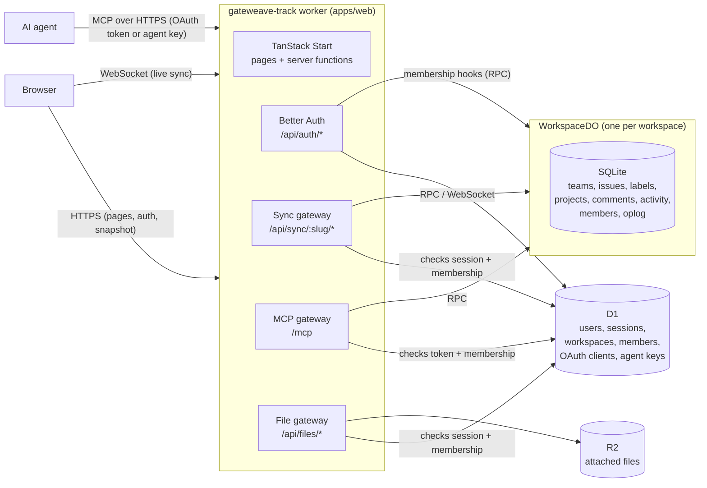

# Architecture

Gateweave Track is a realtime issue tracker that runs entirely on Cloudflare's developer platform.
This document explains how the pieces fit together and why they are built the way they are.

## Overview



Everything ships as **one Worker**:

- **TanStack Start** renders the app and serves server functions.
- **Better Auth** handles accounts, sessions and workspaces. A workspace is a Better Auth
  organization, so members, roles and invitations come from its organization plugin.
- **D1** stores identity and the workspace directory.
- **One Durable Object per workspace** (`WorkspaceDO`, in `packages/sync-server`) stores that
  workspace's content in its own SQLite database and fans changes out to connected clients.
- **R2** keeps the files attached to descriptions and comments.

A single deployable means one `wrangler deploy`, and the client and the sync server can never run
different protocol versions in production. It also gives self-hosters one thing to set up.

## Repository layout

| Path                   | Purpose                                                                  |
| ---------------------- | ------------------------------------------------------------------------ |
| `apps/web`             | The Worker: UI, auth, the sync and MCP gateways, and the D1 schema       |
| `packages/protocol`    | Wire contract shared by client and server: entities, mutations, messages |
| `packages/sync-server` | `WorkspaceDO`: storage, mutation logic, realtime fan-out                 |
| `packages/sync-client` | Browser replica: IndexedDB cache, optimistic mutations, tab coordination |

`protocol` has no server dependencies, so the browser bundle never pulls in database code.

## Data ownership

| Data                                | Lives in     | Owner                              |
| ----------------------------------- | ------------ | ---------------------------------- |
| Users, sessions, OAuth accounts     | D1           | Better Auth                        |
| Workspaces, members, invitations    | D1           | Better Auth organization plugin    |
| OAuth clients, grants, signing keys | D1           | Better Auth MCP plugin             |
| Agent members' keys (hashed)        | D1           | Track's agent members plugin       |
| Teams, issues, labels, projects     | Workspace DO | `sync-server`                      |
| Comments on issues                  | Workspace DO | `sync-server`                      |
| Issue activity (history)            | Workspace DO | `sync-server`, from issue writes   |
| Webhooks, their secrets, deliveries | Workspace DO | `sync-server`, managed by admins   |
| Member replica (name, avatar, role) | Workspace DO | Pushed from D1 by membership hooks |
| Attached files                      | R2           | The file gateway                   |

The DO keeps a replica of membership for two reasons: it authorizes writes (for example, only
admins manage teams) and clients need member names to render assignees. Better Auth hooks push
every join, role change and removal to the DO. The replica also heals itself, because each time a
member connects their current profile is upserted.

### Roles and invitations

Roles are Better Auth's defaults: `owner`, `admin` and `member`. Admins invite people, change
roles, remove members and manage teams. Only owners can make or manage owners, and a workspace
always keeps at least one.

The fourth role, `agent`, is for [agent members](#agent-members). Better Auth does not define it,
so it refuses to invite anyone as an agent or to give the role to anyone; only the agent members
plugin does. Code that decides what a role may do asks `isAdminRole` (in `packages/protocol`)
rather than comparing with `member`, so an agent can never be taken for an admin.

An invitation is for one email address and lasts seven days. Its link is `/invite/:id`. When email
is on and the admin has verified their own address, Track emails the link (see
[Email](#email)). Otherwise, the admin copies the link and sends it themselves. Accepting requires
being signed in with the invited address; Better Auth checks that.

Anyone can sign up with any address, so being signed in with the invited address proves
nothing by itself. Where email is on, accepting also requires a verified address
(`requireEmailVerificationOnInvitation`). An invitation then admits only whoever controls that
inbox, and its id is no longer a secret worth stealing. The invite page offers to email a
verification link that returns there. Sign-up sends one too, with the same return address.

A server without email cannot verify anyone, so there the invitation id is what protects a
workspace: whoever holds the link can join. Only admins see invitation ids. Better Auth hands
them to any member through two endpoints, which would let a member pick up an admin invitation:
- `list-invitations` is limited to admins by a `before` hook in
  `apps/web/src/server/auth/config.ts`.
- `get-full-organization`, which the app does not use, is disabled.

The public invite page only describes pending invitations that have not expired.

### Email

Email goes out through Cloudflare Email Service, from the `EMAIL` binding. It is optional. Track
sends nothing until `EMAIL_FROM` names a sender on a domain onboarded to Email Sending, and
self-hosters can run without email. `apps/web/src/server/email/` holds the sender and the
templates. Each message has both a plain-text and an HTML body. Every name in it is
HTML-escaped and squeezed onto one short line.

| Email          | Sent when                                                                                              | Off without email     |
| -------------- | ------------------------------------------------------------------------------------------------------ | --------------------- |
| Password reset | Someone asks on `/forgot-password`. The link works once, for an hour, and resetting ends every session | No password reset     |
| Invitation     | An admin with a verified address invites someone or presses Resend                                     | Admins share the link |
| Verification   | Someone signs up, or asks on an invitation or the members page. The link works for 24 hours            | Nobody is verified    |

Better Auth sends email after the response, through `waitUntil`. Reset requests therefore take
the same time whether or not the account exists. Invitations put text chosen by a stranger,
such as their name and their workspace name, in front of any address, sent from our domain. So
only inviters who verified their own address trigger an email. Each person can send at most 100
invitation emails a day, and invite-member requests are rate limited to 20 a minute. Whatever
the kind, one address gets at most 5 emails at once and 10 a day; past that, email to it is
dropped without telling the requester.

### Rate limits

Better Auth limits each client address per path: 3 sign-in attempts per 10 seconds, 3 password
reset requests a minute, and so on (`apps/web/src/server/rate-limit/`). Paths with a rule of
their own are counted in a `RateLimiter` Durable Object, one per client address and path, so a
limit holds across every isolate and location. Each such rule also gets an hourly allowance of
20 times its burst, so a client that paces itself is held to 60 sign-in attempts an hour.
Everything else, mostly session checks, keeps Better Auth's default of 100 per 10 seconds in
the isolate's memory, so it never waits on a Durable Object. The email cap uses the same
Durable Object, keyed by recipient. Keys are hashed before they become Durable Object names.

Limits use the generic cell rate algorithm: a burst of `max`, then one every `window / max`
seconds, with one timestamp of state per rule. If a `RateLimiter` cannot be reached, the
isolate counts on its own rather than refuse or allow everyone.

### The public demo

Gateweave runs a public demo at https://track-demo.gateweave.com, as its own deployment: the
`demo` environment in `wrangler.jsonc`
(`pnpm --filter @gateweave/track-web deploy:demo`, with `db:migrate:demo` for its database). It
is a separate Worker with its own D1 database and Durable Objects, and it shares nothing with
production. Self-hosters do not need it, and the code stays inert on any deployment where the
`TRACK_DEMO` variable is not `"1"`: the server function, the cleanup and the sign-in changes all
check it first. To try it locally, add `TRACK_DEMO=1` to `.dev.vars` and restart `pnpm dev`.

A shared demo account would be vandalized within minutes, so each visitor gets a sandbox:

- The login page offers one button. Pressing it calls the `startDemo` server function
  (`src/server/demo/start.ts`), which limits each client network to 20 sandboxes an hour and 100
  a day (an IPv4 address, or an IPv6 /64 as Better Auth counts it; generous because of
  carrier-grade NAT), creates a visitor account with Better Auth's server API (a random address under
  `visitors.example.com`, a password nobody sees), and signs the visitor in.
- It then creates a workspace named "Acme" through the server API, so the organization hooks
  sync membership as usual. The visitor owns it. Four sample people (Maya, Sam, Lena, Diego) are
  members; they are users with no credentials, shared by every sandbox. The sample teams, labels,
  issues and comments are written through the Durable Object's `mutate` RPC, each as the right
  person, from the same steps `pnpm dev:seed` uses (`src/server/demo/sample.ts`).
- In the demo, HTTP requests to sign up, sign in, reset or change a password or email, and
  delete an account are refused. Only the server creates accounts. Server-side `auth.api` calls
  carry no `Request`, which is how the hook tells them apart. Email is off.
- A Cron Trigger runs every 10 minutes (`src/server/demo/cleanup.ts`). It deletes visitors more
  than a day old: for each of their workspaces it calls `destroy()` on the Durable Object, then
  deletes the organization row, then the user (sessions, accounts and memberships cascade). The
  sample people are never selected. Visitors are found by their address, so a failed run leaves
  what it did not delete for the next one.

Seeding a sandbox makes about 70 Durable Object calls in one request, so the demo needs a Workers
Paid plan (1,000 subrequests per request).
## Request flow and security

The Durable Object has **no public route**. Only the Worker can reach it, through its binding.

1. A request to `/api/sync/:slug/snapshot` or `/api/sync/:slug/socket` reaches the gateway
   (`apps/web/src/server/sync.ts`) before TanStack Start sees it.
2. The gateway checks the `Origin` header. WebSocket handshakes carry cookies cross-site, so the
   origin must match.
3. It loads the Better Auth session and resolves the slug to a membership in D1. Non-members get
   the same `404` as a missing workspace, so slugs cannot be probed.
4. It forwards the request to `WORKSPACE.getByName(workspaceId)`. A snapshot request becomes an
   RPC call. A socket request is forwarded with the verified member in an internal header that
   the client cannot set.

The DO is keyed by workspace id, not slug, so renaming a workspace does not move its data.

`HEAD /api/sync/:slug/snapshot` runs the same checks without touching the DO. A browser cannot
see the HTTP status of a refused WebSocket handshake, so the client uses this probe to tell
"offline" apart from "signed out" or "no longer a member".

Better Auth limits how often each client calls `/api/auth/*`. For example, it allows 3 sign-in
attempts per 10 seconds and 3 password-reset requests per minute. It identifies the client by
`CF-Connecting-IP`. Cloudflare sets that header and clients cannot. Counts are kept in memory,
per isolate, so the limit slows guessing but is not a hard cap.

### AI agents (MCP)

`/mcp` is a [Model Context Protocol](https://modelcontextprotocol.io) server, so AI agents can
work in Track as the person who connected them. Track is also the OAuth authorization server
that agents sign in to, through Better Auth's MCP plugin:

1. An agent calls `/mcp` without a token and gets a `401` pointing to the protected resource
   metadata (`/.well-known/oauth-protected-resource/mcp`), which names Track's authorization
   server.
2. The agent registers itself (dynamic client registration) and sends the person to authorize,
   with PKCE. They sign in if needed and approve it on `/oauth/consent`. Anyone can register a
   client under any name, so the consent page also says where the grant will go, and consent is
   never skipped.
3. The agent gets an access token, a JWT bound to the `/mcp` URL with the `track` scope, and a
   refresh token. The gateway (`apps/web/src/server/mcp/index.ts`) verifies the signature, the
   audience and the scope (`protect.ts`). It reads Track's signing keys in-process rather than
   from the JWKS URL, because a Worker cannot reliably fetch its own hostname. Session cookies are
   never accepted there, so a web page cannot make a signed-in browser call it, and no Origin
   check is needed.

Each tool call resolves the workspace slug to the caller's membership in D1, as the sync gateway
does, and then reads or mutates through the Durable Object's RPC (see
[Server-side clients](#server-side-clients)). A workspace the caller does not belong to is
reported as not found. The tools themselves live in `apps/web/src/server/mcp/tools.ts`. Agents
read an issue's comments with `get_issue` and write one with `add_comment`, as the person. An
agent sets up a fresh workspace's teams with `create_team`, which only admins may use. It makes
and changes projects with `create_project` and `update_project`, which go through the same
mutations as the app, so the server's rules apply: an agent member cannot, and a lead must be a
person.

Tokens must name one canonical URL, so the endpoint, and the authorization server, exist only
when `BETTER_AUTH_URL` pins the base URL. Without it `/mcp` answers `404`.

### Agent members

An agent member is a member an admin creates for an AI agent that works on its own, such as one
that triages new issues, rather than for a person. It is a Better Auth user with the `agent`
role in one workspace, made by the agent members plugin (`apps/web/src/server/auth/agents.ts`),
which also lists, renames and deletes agents and makes and revokes their keys, for admins only.
Settings has an Agents page for it.

- **It never signs in.** It has no password or account, and its address is `<id>@agents.invalid`,
  a domain that can never resolve. The plugin refuses that domain wherever Better Auth takes an
  address (sign-up, sign-in, password reset, verification, email change and invitations), and
  refuses changing an agent's role or removing it through the members endpoints: deleting it from
  its own settings also revokes its keys.
- **It works through MCP with a key.** A key is `gwt_` and 43 random characters (256 bits). D1
  keeps its SHA-256 hash and its first 12 characters, to tell keys apart in settings, and the time
  it was last used, written at most every five minutes. An agent can have five keys, so one can be
  replaced without a gap. The MCP gateway takes a `Bearer` key before trying OAuth, finds the
  agent while it is still an agent member of the workspace the key was made for, and lets it
  reach that workspace only, even should it come to belong to another.
- **It acts as itself.** Its tool calls go through `mutate` with its own profile, so the same
  validation applies, the oplog and activity name it, and people see its changes live. It can do
  what members do and nothing only admins can. The app shows it with a robot for an avatar.
- **It proposes what an admin chooses.** An admin picks the kinds of change it only proposes
  (see [Proposals](#proposals)); everything else it makes directly.
- **It goes with its workspace.** Deleting an agent deletes its user, membership and keys; the
  workspace keeps its profile, marked removed, for what it did. Deleting a workspace deletes its
  agents too, as does the demo's cleanup.

## Sync protocol

Defined in `packages/protocol`. The server is authoritative. Clients apply changes optimistically
and reconcile against what the server broadcasts.

### Versions and the oplog

Every write appends one or more ops to the workspace's **oplog**. Each op gets the next workspace
version, so versions are gapless and totally ordered. An op is either a full-row `put` or a
`delete` for a `team`, `issue`, `label`, `project`, `comment`, `activity`, `proposal` or `member`.
A client's entire sync state is the highest version it has applied.

### Connecting

1. `GET /api/sync/:slug/snapshot` returns
   `{ version, teams, issues, labels, projects, comments, activities, proposals, members }`,
   leaving out the comments, activity and proposals of deleted issues, and deleted projects. It is served over HTTP so it can be compressed and fetched in
   parallel with the socket.
2. The client opens the socket and sends `hello { protocol, clientId, since: snapshot.version }`.
3. The server streams any ops after `since` as `delta` messages, then `ready { version }`. From
   then on the socket receives every new op live.

If `since` is older than the compaction floor, or newer than the server (for example, after a
local database wipe), the server replies `reset` and the client fetches a new snapshot. A
protocol version mismatch closes the socket with code `4001` so the client can prompt a reload.

Clients keep the socket alive by sending the plain-text frame `ping`. The runtime answers `pong`
without waking a hibernated Durable Object.

### Mutations

```jsonc
{
	"type": "mutate",
	"id": "<uuid>",
	"mutation": {
		"name": "issue.update",
		"args": {
			/* … */
		}
	}
}
```

- The server applies each mutation in its own SQLite transaction. A rejection rolls back every
  write the mutation made.
- The resulting ops go to **every** live socket, including the sender, as a `delta`. The sender
  then gets `ack { id, version }`. A client therefore learns the canonical result of its own
  mutation the same way it learns about everyone else's.
- A rejection is `reject { id, reason, message }` with reason `invalid`, `forbidden`,
  `not_found` or `conflict`. The client drops the mutation and its optimistic effect.
- Mutation ids are recorded, so resending a mutation after a reconnect is safe. A repeat returns
  the original version without writing again.
- A message that is not valid protocol closes the socket with `4400`. A mutation that is valid
  protocol but has an invalid body is rejected by id, and the connection stays open.

### Server-side clients

Code that acts for a member on the server, such as an AI agent's tool call, does not keep a
replica. It reads slices of the workspace over RPC (`directory`, `issues`, `issue`, `issueByKey`) and
writes with `mutate(member, clientId, mutationId, mutation)`. That runs the same path as a socket
mutation: the same validation, idempotency by mutation id, field-level conflict detection and
broadcast to every live socket. It returns the equivalent of an `ack` or a `reject`. As with
sockets, only a gateway calls it, after verifying the member. Today that is the MCP gateway,
which gives each OAuth client, and each agent member, one stable `clientId` and every call a fresh
mutation id.

### Concurrent edits

Issue updates use **field-level optimistic concurrency**. An update carries the `baseVersion` of
the issue the client edited. Each field in the patch is applied unless _another client_ wrote
that same field after `baseVersion`.

- Two people editing different fields of the same issue both succeed.
- A client coming back online with a stale edit to a field someone else has since changed is
  rejected for that field instead of silently overwriting newer work.
- A client's own rapid successive edits never conflict with each other, even when they are all
  based on the same version because earlier acks have not arrived yet.

If only some fields conflict, the rest are applied. The client sees the outcome in the broadcast
row.

Labels are kept out of the patch. An issue's `labelIds` change only through `issue.addLabel` and
`issue.removeLabel`, which are set operations: adding a label that is already there, or removing
one that is not, writes nothing. They never conflict, so two people labeling the same issue at the
same time both get their label. Deleting a label (admins only) removes it from every issue that
has it, one issue op each, before the label's own delete op.

### Projects

A project groups issues from any team toward a goal. It has a name, a description, a status
(planned, started, paused, completed or canceled), a lead and a target date (`YYYY-MM-DD`, checked
to be a real day). An issue belongs to at most one project through its `projectId`.

- `project.create` and `project.update` are open to any person; an agent member is refused.
  `leadId` must be a person who is an active member, as an assignee must be a member, and not an
  agent. Projects have no version: two people editing one concurrently, the last edit wins.
- `project.delete` is for owners and admins, decided with `isAdminRole`. Like a label, the
  project keeps its row on the server and leaves clients, and it takes itself off every issue
  that has it: one issue op each, before the project's own delete op, so replicas update.
  Deleting writes no history, as deleting a label does.
- `issue.create` and `issue.update` refuse a `projectId` that is missing or deleted
  (`not_found`). `projectId` is an ordinary field of the issue patch, with the same per-field
  conflict detection as the status or the assignee.
- Progress is not stored. The UI counts the issues in the project that are done, out of all that
  are not canceled, from the local copy.
- Changing an issue's project is recorded in its history, and is one of the kinds of change an
  admin can have an agent propose (`project`).

The Projects page (`/$workspace/projects`) lists them with their lead, target date and progress,
and a project's page (`/$workspace/project/$projectId`) edits its fields above the project's
issues, shown with the same list and board as a team's.

### Sub-issues

An issue can be part of another, its parent (`parentId`), in any team of the workspace, so large
work breaks down into pieces that different teams own. The parent is an ordinary field of the
issue patch, with per-field conflict detection, and each change is recorded in the issue's
history.

- **No loops.** `issue.create` and `issue.update` refuse a parent that is the issue itself, or
  is under it at any depth (`invalid`), and one that is missing or deleted (`not_found`). The
  check walks up from the new parent inside the mutation's transaction, so two people making
  issues each other's parents at the same moment cannot both succeed.
- **Deleting a parent keeps its sub-issues**, as top-level issues: one issue op each, before the
  parent's own delete op, and no history, as deleting a project does. So every issue's ancestors
  are live.
- **Never proposed.** Like dates and estimates, an agent member sets a parent directly.
- **Progress is not stored.** The UI counts the sub-issues that are done, out of all that are not
  canceled, from the local copy, as it does for projects.

The issue page shows the parent above the title and lists sub-issues under the description, with
a field that adds one in the parent's team. Lists and boards show a parent's progress. Agents set
`parent` with `create_issue` and `update_issue`, read an issue's sub-issues with `get_issue`,
and find them with `search_issues`.

### Relations

Issues in any teams can be related: one blocks another, is a duplicate of it, or is related to it.
A relation is an entity of its own (`IssueRelation`), not a field of either issue, made with
`relation.create` and removed with `relation.delete`. `blocks` and `duplicate` read from
`issueId` to `relatedIssueId`; `related` has no direction. `relationFrom` and `relationOf` in
`packages/protocol` turn a relation into what it is from one issue's side (`blocked_by`,
`duplicated_by`, …) and back.

- **One relation per pair of issues.** A new relation between two issues replaces the one they
  have, so marking a related issue as a duplicate needs no removal first, and making the relation
  they already have does nothing. The server finds the pair's relation inside the mutation's
  transaction, and the client predicts the same.
- **Both issues must be live**, and distinct. Deleting an issue removes its relations: one delete
  op each, before the issue's own, and no history on the other issues. Relations leave no row
  behind, unlike most entities: the history keeps the record.
- **History on both sides.** Each issue gets an entry from its own side (`blocks` on one,
  `blocked_by` on the other). A relation added and removed by the same person within the merge
  window leaves nothing, as a label toggled back does.
- **Open to every member, agents included, and never proposed.** No webhook events yet.
- **"Blocked" is not stored.** Lists and boards mark an open issue that an open issue blocks,
  computed from the local copy. An open issue marked as a duplicate offers "Close as duplicate",
  which cancels it; marking it does not close it by itself.

The issue page lists relations by kind under the sub-issues, with a menu that adds one (the kind,
then the issue) and a button on each that removes it. Agents read relations with `get_issue`,
and add and remove them with `link_issues` and `unlink_issues`.

### Dates and estimates

An issue can have a start date and a due date (`startDate`, `dueDate`: `YYYY-MM-DD`, checked to
be a real day, like a project's target date) and an estimate (`estimate`: whole points from 0 to
1000). They are ordinary fields of the issue patch, with per-field conflict detection, and each
change is recorded in the issue's history.

- A day is a day on the calendar, the same in every time zone, not an instant. "Overdue" is
  decided in the viewer's time zone: an issue that is not done or canceled, whose due date is
  before today.
- The server does not require the start to come before the due date. The issue page only keeps
  them in order in the date pickers.
- Teams pick their own scale. The UI offers 1, 2, 3, 5, 8, 13 and 21 points, and shows any other
  value an agent set.
- Dates and estimates are never proposed: an agent member sets them directly, as it can create
  issues. They are planning, which people correct by editing, not a decision about the work.
- Lists and boards show the due date (red once overdue) and the estimate, and a page of issues
  filters to overdue issues, issues due within a week, or issues without a due date (`due` in
  the URL). Agents set all three over MCP with `create_issue` and `update_issue`.

### Comments and activity

Comments are ordinary synced rows. Any member can comment. Only the author edits a comment, so
there is a single writer and the last edit wins without any conflict check. The author or an
admin can delete it.

Activity, an issue's history, is written by the server as a side effect of issue mutations and
never by clients. It cannot be forged, needs no prediction, and arrives in the same delta as the
change it describes. Each entry is one person changing one field: status, priority, assignee,
title, description, project, parent, start date, due date, estimate, or a label added or
removed. To keep the history readable:

- Changes by the same person to the same field within five minutes merge into their latest
  entry, keeping the first `from` and the newest `to`. Putting a field back where it started
  removes the entry.
- The creator writing the title and description in the first five minutes, before there is any
  other history, is part of creating the issue and is not recorded.
- The creation itself is not stored. The UI shows it from the issue's `creatorId` and
  `createdAt`, so issues older than activity still start their history correctly.

Deleting an issue sends delete ops for its comments, activity and proposals ahead of the issue's
own, so clients drop them together. Deleting a label records nothing, and entries about it read
as "a deleted label".

### Markdown and attached files

Descriptions and comments are Markdown, GitHub's flavor (tables, task lists, strikethrough),
rendered by react-markdown with remark-gfm in a chunk of its own that issue pages load. HTML in
the text shows as text and links keep only safe protocols. Links to other sites open in a new tab
with `noreferrer`. Only files attached in the workspace show as images: an image from anywhere
else is a link, because loading it would tell its host who read the issue and when. Task lists
show as written; ticking one is editing the text.

Files live in R2, not in the Durable Object, under `<workspaceId>/<fileId>/<name>`, and the text
links them by the app's path to them, `/api/files/<workspaceId>/<fileId>/<name>`. There is no
table of files: the link is the reference, so a file's name and type travel with it, and a
workspace's files are one prefix in the bucket.

- **The browser makes the link first.** It picks the file's id (a random UUID), puts the link in
  the text at the caret, and uploads behind it with `PUT`, so typing goes on while a large file
  uploads. A failed upload says so and leaves the link to remove. Offline, nothing is attached;
  an outbox for uploads is still to come.
- **The file gateway** (`apps/web/src/server/files.ts`) runs before TanStack Start, as the sync
  gateway does, so uploads stream to R2 unread. It takes the session, checks membership in D1 by
  the workspace id in the path, and answers non-members with the same 404 as a missing file.
  Uploads must come from the app's origin, name a length up to 25 MB, and use a name the browser
  cleaned (`attachmentName` in `apps/web/src/lib/attachments.ts`), so the key has no path
  tricks. An id in use is refused, so a file never changes under its link.
- **A file never runs as a page of the app.** Images (not SVG), audio, video and plain text are
  served inline; everything else as `application/octet-stream` to download. Every response is
  `nosniff`, sandboxed by its Content-Security-Policy and same-origin only. Files cache in the
  browser for a year, privately: a link always means the same bytes.
- **Deleting a workspace deletes its files**, after the response, a page of keys at a time.
  There is no quota yet, and a file stays when the text that linked it changes. The demo has no
  bucket and refuses uploads.

### Proposals

People stay in control of agents: for each agent member, an admin chooses which kinds of change
to an issue it only proposes (`agent.update`, kept in the member's `proposes` in the Durable
Object). The kinds are the title, the description, the status, closing (a status of done or
canceled, which `status` includes), the priority, the assignee, the project and labels.
Creating issues, setting parents, dates and estimates, relating issues, commenting, and managing
labels and projects are never proposed. An agent proposes nothing until an admin says so.

- **The server splits the agent's mutation.** `applyMutation` makes the fields its `proposes`
  does not cover and turns the rest into proposals (`proposals.ts`), in the same transaction.
  A new issue is made without the proposed status, priority, assignee, project or labels, and then
  gets them as proposals. The agent cannot get around this: the split happens where the
  mutation is applied, whatever sent it.
- **One open proposal per agent and field.** Proposing a field again replaces the agent's open
  proposal for it (each label is a field of its own). Proposing what the issue already has
  withdraws it, since the agent's latest word is that nothing needs to change.
- **People decide.** `proposal.accept` makes the change as the person accepting it, through the
  same handlers as their own edit and against the issue as it is now, and the activity entry
  notes the agent in `proposedBy` (it never merges with other entries). `proposal.dismiss`
  leaves the issue alone. No agent decides on a proposal, its own included. A decided proposal
  leaves clients but keeps its row, with who decided and when.
- **The agent is told.** `mutate` answers with what it proposed, and the MCP tools return it
  under `proposed`, so the model knows the change is waiting rather than made. `get_issue`
  lists an issue's open proposals.

The Proposals page (`/$workspace/proposals`) lists the workspace's open proposals grouped by
issue, the most recently touched issue first, and the sidebar badges their count. Every open
proposal is already in the replica, so it reads that and works offline; accepting and dismissing
use the same mutations as the issue page. The agent filter lives in the URL (`?agent=<id>`).

Only open proposals of live issues are in a snapshot. Webhooks report proposals (see
[Webhooks](#webhooks)); an accepted one also sends the `issue.updated` of the person who
accepted it.

### Search

Each workspace's database has a full-text index of its live issues: an FTS5 table
(`packages/sync-server/src/search.ts`, migration `0003`) with one row per issue, holding its key,
title, description and the bodies of its comments. A write that changes any of them rebuilds that
issue's row from the source tables in the same transaction, so the index cannot drift from the
data; renaming a team's key rebuilds its issues' rows. Rows are addressed through
`issue_search_docs`, whose `INTEGER PRIMARY KEY` stays stable where a text-keyed table's implicit
rowid would not. The migration indexes what a workspace already holds when it first wakes after
the deploy.

Matching follows one set of rules, so that server-side clients and the browser find the same
issues. Text is folded to lowercase without diacritics (NFKD, combining marks removed) and split
into runs of letters and digits. An issue matches when every word of the query starts a word in
one of its fields, so "auth" finds "authentication" and "resume" finds "Résumé". The server
quotes each word as an FTS5 prefix query, so query syntax has no effect, and ranks matches with
bm25: the key and title count most, then the description, then comments. MCP's `search_issues`
uses it.

The command palette searches the local replica instead (`apps/web/src/lib/search.ts`), so it
works offline and answers as you type. It applies the same rules over the issues, teams and
comments in memory, caching each row's words for as long as the row object lives, and ranks by
fixed field weights in place of bm25. A query that spells out an issue's key, such as `ENG-12`,
puts that issue first.

### Webhooks

A webhook posts each change to a URL, such as an agent's trigger, so that a service hears about
new issues without holding a socket open. Admins manage them on Settings › Webhooks: a URL, the
events it wants (`issue.created`, `issue.updated`, `issue.deleted`, `comment.created`,
`comment.updated`, `comment.deleted`, `proposal.created`, `proposal.updated`,
`proposal.accepted`, `proposal.dismissed`), an optional team, and optionally the agent member it
sets off. The payload types and input schemas are in `packages/protocol/src/webhooks.ts`; the rest
is `packages/sync-server/src/webhooks.ts`.

- **The workspace's Durable Object delivers them, from an outbox.** Mutation handlers add what
  they did to the change set (an issue created, an issue's fields before and after, a comment),
  and `applyMutation` turns those into one delivery row per matching webhook, in the same
  transaction as the change. A delivery is therefore never lost and never sent for a write that
  rolled back, and a retried mutation id queues nothing again. The write then sets the alarm,
  which sends what is due outside any transaction: ten at a time, ten seconds each, claiming
  rows first so that a restart mid-send retries them. Self-hosting needs no Queue or other
  binding, and secrets never leave the object.
- **Signed per [Standard Webhooks](https://www.standardwebhooks.com).** Each request carries
  `webhook-id` (the delivery's id, the same on every retry), `webhook-timestamp` and
  `webhook-signature` (`v1,` and an HMAC-SHA256 of `id.timestamp.body`, keyed by the `whsec_`
  secret), so any Standard Webhooks library verifies it. The secret is shown once, when the
  webhook is made or its secret replaced.
- **Bodies are `{ type, timestamp, data }`.** `data` has the workspace's id and slug, the
  workspace version after the change, the actor (a person or an agent), and the issue with its
  key, URL and labels (`{ id, name }`, in the order of `labelIds`, with the names as of the
  event). `issue.updated` adds `updatedFrom`, the changed fields' earlier values, so a receiver
  can tell which labels an update added from `updatedFrom.labelIds`; an update that only
  reorders the list is not sent. Comment events add the comment.
- **Proposal events** add the proposal (`id`, `issueId`, `issueKey`, `agentId`, `change`,
  `createdAt`, `updatedAt`) and belong to their issue's team. `proposal.created` is a new open
  proposal and `proposal.updated` the agent proposing the same field again with another value;
  their actor is the agent. `proposal.accepted` and `proposal.dismissed` also carry `decidedBy`
  and `decidedAt`; the actor is the person who decided, or the agent when it withdrew a
  proposal by proposing what the issue already has. So a webhook made for an agent hears when
  people accept or dismiss its proposals, and skips the rest, which it caused. An accepted
  proposal still sends the `issue.updated` of its change. Deleting an issue discards its open
  proposals without a decision and sends no proposal event: `issue.deleted` covers it. New
  webhooks do not subscribe to proposal events by default.
- **Retries.** A delivery that gets no 2xx answer (a redirect counts as a failure) is retried
  after 5 seconds, 5 minutes, 30 minutes, 2, 5 and 10 hours, then marked failed. Settings show
  each webhook's latest deliveries, and finished ones are kept for seven days.
- **No loops, and no self-calls.** A webhook made for an agent is not sent that agent's own
  changes. URLs must be `https` (plain `http` only where the app itself runs on it, which is
  local development) and cannot point at the app's own host, which a Worker cannot fetch.
  Pausing a webhook drops what it had not delivered. A workspace has at most ten.
- **Links follow the slug.** Only the gateway knows the slug and the app's origin, so it passes
  them with every webhook change, and the organization plugin's update hook passes a new slug.
  Management is admin-only twice over: the gateway checks membership in D1, and the object
  refuses a verified member who is not an admin. The public demo sends no webhooks.

### Imports

Issues come in from another tracker through the browser, as the same mutations people make. An
importer (CSV today) only reads its source into a common shape in `apps/web/src/lib/import/`;
`planImport` then matches labels and projects by name, creating the missing ones, and people by
email, then name. It writes parents before their sub-issues and the oldest issues first, so
numbers follow the source's order. Nothing on the server knows about imports, so validation,
permissions and fan-out are the ordinary ones.

- **Repeating an import is safe.** An imported issue's or comment's id is made from its id in
  the source (`import-` and a SHA-256 prefix), and the plan skips ids the workspace already has.
  A run that stopped part way is finished by running it again.
- **Original dates are an admin's to keep.** `issue.create` and `comment.create` take an optional
  `createdAt`, which only owners and admins may send, and the server never lets it be later than
  the mutation. Everyone else's items are created now, as before.
- **Where the item came from stays in its text.** Imported issues and comments belong to the
  importer, so a link to the source, an assignee with no matching member and a comment's original
  author are noted in the Markdown.
- **The importer keeps a window of mutations in flight**, about forty, because every pending
  mutation is replayed on each change from the server. Closing the page stops the import; what
  was sent still lands.

### Compaction

The alarm compacts the oplog every six hours. Ops are dropped only when they are both older than
30 days **and** more than 10,000 versions behind the head. The highest dropped version becomes
the floor, and clients behind it get `reset`. Recorded mutation ids are pruned on the same
schedule, as are finished webhook deliveries. The same alarm sends webhooks, so it also runs
whenever a delivery is due; when compaction is next due is kept in the `meta` table.

## Client sync engine

`packages/sync-client` keeps a replica of one workspace in the browser. Reads are synchronous
and come from memory, so the UI never waits on the network.

### Replica and rebasing

The replica holds two things: the **confirmed** state, exactly as the server last reported it,
and the **pending** mutations this browser has made that the server has not confirmed yet. What
the UI sees is derived: the pending mutations replayed, in order, on top of the confirmed state.

Every server delta updates the confirmed state, and every ack or reject removes a pending
mutation. Either way the visible state is rebuilt. Server results therefore always win, a
rejected mutation simply stops being replayed, and no undo logic is needed. Optimistic
predictions mirror the server's rules closely enough to look right (a new issue gets the next
number in its team); the server's row replaces the prediction as soon as it arrives.

Tables are copy-on-write. A change to issues leaves the teams and members maps untouched, and
unchanged rows keep their identity, so memoized selectors stay valid.

### Storage

The replica is stored in IndexedDB, one database per user and workspace (keyed by ids, so a
renamed workspace keeps its cache). It holds the confirmed rows, the confirmed version and the
pending mutations. A reload renders straight from storage and then catches up from the oplog,
without downloading a snapshot. Pending mutations are written with strict durability, because
until the server has them they exist nowhere else. The database version includes the protocol
version, so a protocol change discards the old cache instead of misreading it. Signing out
deletes every replica, and losing access deletes that workspace's: when the server reports that
the user is no longer a member, or they leave, the app deletes the database, so a removed
member's browser does not keep a copy.

### One connection per browser

When storage is shared, the tabs of a browser elect a **leader** with the Web Locks API. Only the
leader opens a socket. It writes what the server sends to IndexedDB and then announces it to the
other tabs over a `BroadcastChannel`. Followers apply the announcements to their own memory and
send their mutations to the leader the same way. Every tab shows every tab's pending mutations,
so an edit appears everywhere at once.

Announcing only after the write commits keeps tabs consistent: a follower that misses an
announcement, or sees a gap in versions, reloads from storage and is guaranteed to find at least
what it was told about. When the leader closes, the lock passes to the next tab, which connects
and resends any unacknowledged mutations. Mutation ids make that resend safe.

The lock and the channel are named for the replica and the protocol version (`tabsName`). After an
update, a tab still open on the old version leads only the tabs of its own version, which can show
nothing but "Update available". It never holds up a tab on the new version, which would otherwise
wait for a leader that writes the wrong storage and speaks the old messages.

Where IndexedDB or Web Locks are unavailable, each tab keeps its replica in memory and connects
on its own.

### Connection lifecycle

1. Without local data, the leader fetches a snapshot first. Otherwise it connects straight away.
2. It sends `hello` with its confirmed version and applies the catch-up deltas. On `ready` it
   sends every pending mutation in order.
3. On `reset` it fetches a fresh snapshot and says `hello` again. Pending mutations survive.
4. A lost connection is retried with exponential backoff and jitter. Coming back online or
   returning to the tab retries immediately.
5. A ping every 30 seconds detects connections that died silently.
6. A protocol mismatch, an ended session and removal from the workspace are final: the client
   stops and reports why, so the UI can ask for a reload or a sign-in, or explain.

`mutate()` validates its input, applies it optimistically and returns a promise for the server
result. The UI does not wait for it. Rejections also reach an `onReject` callback, so the app can
report them in one place.

### Starting offline

A service worker (`apps/web/service-worker/sw.ts`, built into `/sw.js`) lets the app start with
no connection. When it installs, it caches the build's files and an app shell: what the server
renders for `/_shell`. That is a workspace URL, whose route renders only in the browser, so the
shell is the root layout and the build's scripts, with no data; `_shell` can never be a slug.
Pages are always fetched from the network first. Only when that fails does the worker serve the
shell, and the router then loads the route for the actual URL in the browser. The API, `/mcp`
and `/.well-known` are left alone. Each build gets its own cache, and files named by their
content are copied over from the previous one instead of downloaded again.

The workspace route asks the server for the session and the membership before it renders. When
the server cannot be reached, as opposed to refusing, it falls back to what the browser
remembers: for each workspace opened while signed in, its id, name and the user's role, kept in
`localStorage` (`apps/web/src/lib/offline.ts`). That reveals nothing the replica does not
already hold, and the server checks the session and membership again as soon as the sync client
reconnects. An installed app starts at `/`, which offline opens the workspace used last. Pages
that need the server, such as member settings, say so. Signing out forgets all of it along with
the replicas, and a refusal from the server forgets that workspace, so a shared device does not
open someone else's workspace offline.

### React

`@gateweave/track-sync-client/react` provides `SyncProvider`, `useQuery(selector, isEqual)` and
`useSyncStatus()`, built on `useSyncExternalStore`. A component re-renders only when its
selection changes.

## Testing

`packages/sync-server` tests run inside `workerd` with `@cloudflare/vitest-plugin`. They exercise
the real Durable Object and SQLite storage over real WebSockets.

`packages/sync-client` tests run in Node against the same Durable Object, hosted by Wrangler's
local runtime behind a stand-in for the gateway. The client reaches it through its real `fetch`
and `WebSocket` transport. IndexedDB comes from `fake-indexeddb`, and Node's own
`BroadcastChannel` and Web Locks run the multi-tab code unchanged.
