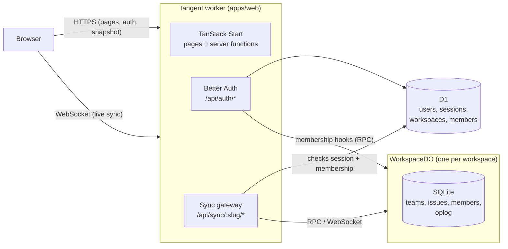

# Architecture

Tangent is a realtime issue tracker that runs entirely on Cloudflare's developer platform. This
document explains how the pieces fit together and why they are built the way they are.

## Overview



Everything ships as **one Worker**:

- **TanStack Start** renders the app and serves server functions.
- **Better Auth** handles accounts, sessions and workspaces. A workspace is a Better Auth
  organization, so members, roles and invitations come from its organization plugin.
- **D1** stores identity and the workspace directory.
- **One Durable Object per workspace** (`WorkspaceDO`, in `packages/sync-server`) stores that
  workspace's content in its own SQLite database and fans changes out to connected clients.

A single deployable means one `wrangler deploy`, and the client and the sync server can never run
different protocol versions in production. It also gives self-hosters one thing to set up.

## Repository layout

| Path                   | Purpose                                                                  |
| ---------------------- | ------------------------------------------------------------------------ |
| `apps/web`             | The Worker: UI, auth, the sync gateway, and the D1 schema                |
| `packages/protocol`    | Wire contract shared by client and server: entities, mutations, messages |
| `packages/sync-server` | `WorkspaceDO`: storage, mutation logic, realtime fan-out                 |

`protocol` has no server dependencies, so the browser bundle never pulls in database code.

## Data ownership

| Data                                | Lives in     | Owner                              |
| ----------------------------------- | ------------ | ---------------------------------- |
| Users, sessions, OAuth accounts     | D1           | Better Auth                        |
| Workspaces, members, invitations    | D1           | Better Auth organization plugin    |
| Teams, issues                       | Workspace DO | `sync-server`                      |
| Member replica (name, avatar, role) | Workspace DO | Pushed from D1 by membership hooks |

The DO keeps a replica of membership for two reasons: it authorizes writes (for example, only
admins manage teams) and clients need member names to render assignees. Better Auth hooks push
every join, role change and removal to the DO. The replica also heals itself, because each time a
member connects their current profile is upserted.

## Request flow and security

The Durable Object has **no public route**. Only the Worker can reach it, through its binding.

1. A request to `/api/sync/:slug/snapshot` or `/api/sync/:slug/socket` reaches the gateway
   (`apps/web/src/server/sync.ts`) before TanStack Start sees it.
2. The gateway checks the `Origin` header. WebSocket handshakes carry cookies cross-site, so the
   origin must match.
3. It loads the Better Auth session and resolves the slug to a membership in D1. Non-members get
   the same `404` as a missing workspace, so slugs cannot be probed.
4. It forwards the request to `WORKSPACE.getByName(workspaceId)`. A snapshot request becomes an
   RPC call. A socket request is forwarded with the verified member in an internal header that
   the client cannot set.

The DO is keyed by workspace id, not slug, so renaming a workspace does not move its data.

## Sync protocol

Defined in `packages/protocol`. The server is authoritative. Clients apply changes optimistically
and reconcile against what the server broadcasts.

### Versions and the oplog

Every write appends one or more ops to the workspace's **oplog**. Each op gets the next workspace
version, so versions are gapless and totally ordered. An op is either a full-row `put` or a
`delete` for a `team`, `issue` or `member`. A client's entire sync state is the highest version
it has applied.

### Connecting

1. `GET /api/sync/:slug/snapshot` returns `{ version, teams, issues, members }`. It is served over
   HTTP so it can be compressed and fetched in parallel with the socket.
2. The client opens the socket and sends `hello { protocol, clientId, since: snapshot.version }`.
3. The server streams any ops after `since` as `delta` messages, then `ready { version }`. From
   then on the socket receives every new op live.

If `since` is older than the compaction floor, or newer than the server (for example, after a
local database wipe), the server replies `reset` and the client fetches a new snapshot. A
protocol version mismatch closes the socket with code `4001` so the client can prompt a reload.

Clients keep the socket alive by sending the plain-text frame `ping`. The runtime answers `pong`
without waking a hibernated Durable Object.

### Mutations

```jsonc
{
	"type": "mutate",
	"id": "<uuid>",
	"mutation": {
		"name": "issue.update",
		"args": {
			/* … */
		}
	}
}
```

- The server applies each mutation in its own SQLite transaction. A rejection rolls back every
  write the mutation made.
- The resulting ops go to **every** live socket, including the sender, as a `delta`. The sender
  then gets `ack { id, version }`. A client therefore learns the canonical result of its own
  mutation the same way it learns about everyone else's.
- A rejection is `reject { id, reason, message }` with reason `invalid`, `forbidden`,
  `not_found` or `conflict`. The client drops the mutation and its optimistic effect.
- Mutation ids are recorded, so resending a mutation after a reconnect is safe. A repeat returns
  the original version without writing again.
- A message that is not valid protocol closes the socket with `4400`. A mutation that is valid
  protocol but has an invalid body is rejected by id, and the connection stays open.

### Concurrent edits

Issue updates use **field-level optimistic concurrency**. An update carries the `baseVersion` of
the issue the client edited. Each field in the patch is applied unless _another client_ wrote
that same field after `baseVersion`.

- Two people editing different fields of the same issue both succeed.
- A client coming back online with a stale edit to a field someone else has since changed is
  rejected for that field instead of silently overwriting newer work.
- A client's own rapid successive edits never conflict with each other, even when they are all
  based on the same version because earlier acks have not arrived yet.

If only some fields conflict, the rest are applied. The client sees the outcome in the broadcast
row.

### Compaction

An alarm compacts the oplog every six hours. Ops are dropped only when they are both older than
30 days **and** more than 10,000 versions behind the head. The highest dropped version becomes
the floor, and clients behind it get `reset`. Recorded mutation ids are pruned on the same
schedule.

## Testing

`packages/sync-server` tests run inside `workerd` with `@cloudflare/vitest-plugin`. They exercise
the real Durable Object and SQLite storage over real WebSockets.
