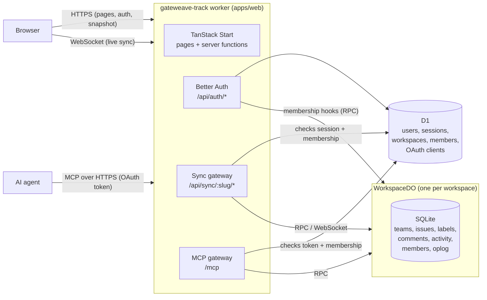

# Architecture

Gateweave Track is a realtime issue tracker that runs entirely on Cloudflare's developer platform.
This document explains how the pieces fit together and why they are built the way they are.

## Overview



Everything ships as **one Worker**:

- **TanStack Start** renders the app and serves server functions.
- **Better Auth** handles accounts, sessions and workspaces. A workspace is a Better Auth
  organization, so members, roles and invitations come from its organization plugin.
- **D1** stores identity and the workspace directory.
- **One Durable Object per workspace** (`WorkspaceDO`, in `packages/sync-server`) stores that
  workspace's content in its own SQLite database and fans changes out to connected clients.

A single deployable means one `wrangler deploy`, and the client and the sync server can never run
different protocol versions in production. It also gives self-hosters one thing to set up.

## Repository layout

| Path                   | Purpose                                                                  |
| ---------------------- | ------------------------------------------------------------------------ |
| `apps/web`             | The Worker: UI, auth, the sync and MCP gateways, and the D1 schema       |
| `packages/protocol`    | Wire contract shared by client and server: entities, mutations, messages |
| `packages/sync-server` | `WorkspaceDO`: storage, mutation logic, realtime fan-out                 |
| `packages/sync-client` | Browser replica: IndexedDB cache, optimistic mutations, tab coordination |

`protocol` has no server dependencies, so the browser bundle never pulls in database code.

## Data ownership

| Data                                | Lives in     | Owner                              |
| ----------------------------------- | ------------ | ---------------------------------- |
| Users, sessions, OAuth accounts     | D1           | Better Auth                        |
| Workspaces, members, invitations    | D1           | Better Auth organization plugin    |
| OAuth clients, grants, signing keys | D1           | Better Auth MCP plugin             |
| Teams, issues, labels, comments     | Workspace DO | `sync-server`                      |
| Issue activity (history)            | Workspace DO | `sync-server`, from issue writes   |
| Member replica (name, avatar, role) | Workspace DO | Pushed from D1 by membership hooks |

The DO keeps a replica of membership for two reasons: it authorizes writes (for example, only
admins manage teams) and clients need member names to render assignees. Better Auth hooks push
every join, role change and removal to the DO. The replica also heals itself, because each time a
member connects their current profile is upserted.

### Roles and invitations

Roles are Better Auth's defaults: `owner`, `admin` and `member`. Admins invite people, change
roles, remove members and manage teams. Only owners can make or manage owners, and a workspace
always keeps at least one.

An invitation is for one email address and lasts seven days. Until email sending lands, an admin
creates a link (`/invite/:id`) and sends it themselves. Accepting requires being signed in with
the invited address; Better Auth checks that.

Email addresses are not verified yet, so anyone can sign up with any address, and the invitation
id is what actually protects a workspace: whoever holds the link can join. So only admins see
invitation ids. Better Auth hands them to any member through two endpoints, which would let a
member pick up an admin invitation: `list-invitations` is limited to admins by a `before` hook in
`apps/web/src/server/auth/config.ts`, and `get-full-organization`, which the app does not use, is
disabled. The public invite page only describes pending invitations that have not expired.
Verified email addresses, with `requireEmailVerificationOnInvitation`, are on the launch
checklist.

## Request flow and security

The Durable Object has **no public route**. Only the Worker can reach it, through its binding.

1. A request to `/api/sync/:slug/snapshot` or `/api/sync/:slug/socket` reaches the gateway
   (`apps/web/src/server/sync.ts`) before TanStack Start sees it.
2. The gateway checks the `Origin` header. WebSocket handshakes carry cookies cross-site, so the
   origin must match.
3. It loads the Better Auth session and resolves the slug to a membership in D1. Non-members get
   the same `404` as a missing workspace, so slugs cannot be probed.
4. It forwards the request to `WORKSPACE.getByName(workspaceId)`. A snapshot request becomes an
   RPC call. A socket request is forwarded with the verified member in an internal header that
   the client cannot set.

The DO is keyed by workspace id, not slug, so renaming a workspace does not move its data.

`HEAD /api/sync/:slug/snapshot` runs the same checks without touching the DO. A browser cannot
see the HTTP status of a refused WebSocket handshake, so the client uses this probe to tell
"offline" apart from "signed out" or "no longer a member".

Better Auth limits how often each client calls `/api/auth/*`. For example, it allows 3 sign-in
attempts per 10 seconds and 3 password-reset requests per minute. It identifies the client by
`CF-Connecting-IP`. Cloudflare sets that header and clients cannot. Counts are kept in memory,
per isolate, so the limit slows guessing but is not a hard cap.

### AI agents (MCP)

`/mcp` is a [Model Context Protocol](https://modelcontextprotocol.io) server, so AI agents can
work in Track as the person who connected them. Track is also the OAuth authorization server
that agents sign in to, through Better Auth's MCP plugin:

1. An agent calls `/mcp` without a token and gets a `401` pointing to the protected resource
   metadata (`/.well-known/oauth-protected-resource/mcp`), which names Track's authorization
   server.
2. The agent registers itself (dynamic client registration) and sends the person to authorize,
   with PKCE. They sign in if needed and approve it on `/oauth/consent`. Anyone can register a
   client under any name, so the consent page also says where the grant will go, and consent is
   never skipped.
3. The agent gets an access token, a JWT bound to the `/mcp` URL with the `track` scope, and a
   refresh token. The gateway (`apps/web/src/server/mcp/index.ts`) verifies the signature, the
   audience and the scope (`protect.ts`). It reads Track's signing keys in-process rather than
   from the JWKS URL, because a Worker cannot reliably fetch its own hostname. Session cookies are
   never accepted there, so a web page cannot make a signed-in browser call it, and no Origin
   check is needed.

Each tool call resolves the workspace slug to the caller's membership in D1, as the sync gateway
does, and then reads or mutates through the Durable Object's RPC (see
[Server-side clients](#server-side-clients)). A workspace the caller does not belong to is
reported as not found. The tools themselves live in `apps/web/src/server/mcp/tools.ts`. Agents
read an issue's comments with `get_issue` and write one with `add_comment`, as the person.

Tokens must name one canonical URL, so the endpoint, and the authorization server, exist only
when `BETTER_AUTH_URL` pins the base URL. Without it `/mcp` answers `404`.

## Sync protocol

Defined in `packages/protocol`. The server is authoritative. Clients apply changes optimistically
and reconcile against what the server broadcasts.

### Versions and the oplog

Every write appends one or more ops to the workspace's **oplog**. Each op gets the next workspace
version, so versions are gapless and totally ordered. An op is either a full-row `put` or a
`delete` for a `team`, `issue`, `label`, `comment`, `activity` or `member`. A client's entire sync state is the highest version
it has applied.

### Connecting

1. `GET /api/sync/:slug/snapshot` returns
   `{ version, teams, issues, labels, comments, activities, members }`, leaving out the comments
   and activity of deleted issues. It is served over HTTP so it can be compressed and fetched in
   parallel with the socket.
2. The client opens the socket and sends `hello { protocol, clientId, since: snapshot.version }`.
3. The server streams any ops after `since` as `delta` messages, then `ready { version }`. From
   then on the socket receives every new op live.

If `since` is older than the compaction floor, or newer than the server (for example, after a
local database wipe), the server replies `reset` and the client fetches a new snapshot. A
protocol version mismatch closes the socket with code `4001` so the client can prompt a reload.

Clients keep the socket alive by sending the plain-text frame `ping`. The runtime answers `pong`
without waking a hibernated Durable Object.

### Mutations

```jsonc
{
	"type": "mutate",
	"id": "<uuid>",
	"mutation": {
		"name": "issue.update",
		"args": {
			/* … */
		}
	}
}
```

- The server applies each mutation in its own SQLite transaction. A rejection rolls back every
  write the mutation made.
- The resulting ops go to **every** live socket, including the sender, as a `delta`. The sender
  then gets `ack { id, version }`. A client therefore learns the canonical result of its own
  mutation the same way it learns about everyone else's.
- A rejection is `reject { id, reason, message }` with reason `invalid`, `forbidden`,
  `not_found` or `conflict`. The client drops the mutation and its optimistic effect.
- Mutation ids are recorded, so resending a mutation after a reconnect is safe. A repeat returns
  the original version without writing again.
- A message that is not valid protocol closes the socket with `4400`. A mutation that is valid
  protocol but has an invalid body is rejected by id, and the connection stays open.

### Server-side clients

Code that acts for a member on the server, such as an AI agent's tool call, does not keep a
replica. It reads slices of the workspace over RPC (`directory`, `issues`, `issue`, `issueByKey`) and
writes with `mutate(member, clientId, mutationId, mutation)`. That runs the same path as a socket
mutation: the same validation, idempotency by mutation id, field-level conflict detection and
broadcast to every live socket. It returns the equivalent of an `ack` or a `reject`. As with
sockets, only a gateway calls it, after verifying the member. Today that is the MCP gateway,
which gives each OAuth client one stable `clientId` and every call a fresh mutation id.

### Concurrent edits

Issue updates use **field-level optimistic concurrency**. An update carries the `baseVersion` of
the issue the client edited. Each field in the patch is applied unless _another client_ wrote
that same field after `baseVersion`.

- Two people editing different fields of the same issue both succeed.
- A client coming back online with a stale edit to a field someone else has since changed is
  rejected for that field instead of silently overwriting newer work.
- A client's own rapid successive edits never conflict with each other, even when they are all
  based on the same version because earlier acks have not arrived yet.

If only some fields conflict, the rest are applied. The client sees the outcome in the broadcast
row.

Labels are kept out of the patch. An issue's `labelIds` change only through `issue.addLabel` and
`issue.removeLabel`, which are set operations: adding a label that is already there, or removing
one that is not, writes nothing. They never conflict, so two people labeling the same issue at the
same time both get their label. Deleting a label (admins only) removes it from every issue that
has it, one issue op each, before the label's own delete op.

### Comments and activity

Comments are ordinary synced rows. Any member can comment. Only the author edits a comment, so
there is a single writer and the last edit wins without any conflict check. The author or an
admin can delete it.

Activity, an issue's history, is written by the server as a side effect of issue mutations and
never by clients. It cannot be forged, needs no prediction, and arrives in the same delta as the
change it describes. Each entry is one person changing one field: status, priority, assignee,
title, description, or a label added or removed. To keep the history readable:

- Changes by the same person to the same field within five minutes merge into their latest
  entry, keeping the first `from` and the newest `to`. Putting a field back where it started
  removes the entry.
- The creator writing the title and description in the first five minutes, before there is any
  other history, is part of creating the issue and is not recorded.
- The creation itself is not stored. The UI shows it from the issue's `creatorId` and
  `createdAt`, so issues older than activity still start their history correctly.

Deleting an issue sends delete ops for its comments and activity ahead of the issue's own, so
clients drop them together. Deleting a label records nothing, and entries about it read as "a
deleted label".

### Compaction

An alarm compacts the oplog every six hours. Ops are dropped only when they are both older than
30 days **and** more than 10,000 versions behind the head. The highest dropped version becomes
the floor, and clients behind it get `reset`. Recorded mutation ids are pruned on the same
schedule.

## Client sync engine

`packages/sync-client` keeps a replica of one workspace in the browser. Reads are synchronous
and come from memory, so the UI never waits on the network.

### Replica and rebasing

The replica holds two things: the **confirmed** state, exactly as the server last reported it,
and the **pending** mutations this browser has made that the server has not confirmed yet. What
the UI sees is derived: the pending mutations replayed, in order, on top of the confirmed state.

Every server delta updates the confirmed state, and every ack or reject removes a pending
mutation. Either way the visible state is rebuilt. Server results therefore always win, a
rejected mutation simply stops being replayed, and no undo logic is needed. Optimistic
predictions mirror the server's rules closely enough to look right (a new issue gets the next
number in its team); the server's row replaces the prediction as soon as it arrives.

Tables are copy-on-write. A change to issues leaves the teams and members maps untouched, and
unchanged rows keep their identity, so memoized selectors stay valid.

### Storage

The replica is stored in IndexedDB, one database per user and workspace (keyed by ids, so a
renamed workspace keeps its cache). It holds the confirmed rows, the confirmed version and the
pending mutations. A reload renders straight from storage and then catches up from the oplog,
without downloading a snapshot. Pending mutations are written with strict durability, because
until the server has them they exist nowhere else. The database version includes the protocol
version, so a protocol change discards the old cache instead of misreading it. Signing out
deletes every replica, and losing access deletes that workspace's: when the server reports that
the user is no longer a member, or they leave, the app deletes the database, so a removed
member's browser does not keep a copy.

### One connection per browser

When storage is shared, the tabs of a browser elect a **leader** with the Web Locks API. Only the
leader opens a socket. It writes what the server sends to IndexedDB and then announces it to the
other tabs over a `BroadcastChannel`. Followers apply the announcements to their own memory and
send their mutations to the leader the same way. Every tab shows every tab's pending mutations,
so an edit appears everywhere at once.

Announcing only after the write commits keeps tabs consistent: a follower that misses an
announcement, or sees a gap in versions, reloads from storage and is guaranteed to find at least
what it was told about. When the leader closes, the lock passes to the next tab, which connects
and resends any unacknowledged mutations. Mutation ids make that resend safe.

Where IndexedDB or Web Locks are unavailable, each tab keeps its replica in memory and connects
on its own.

### Connection lifecycle

1. Without local data, the leader fetches a snapshot first. Otherwise it connects straight away.
2. It sends `hello` with its confirmed version and applies the catch-up deltas. On `ready` it
   sends every pending mutation in order.
3. On `reset` it fetches a fresh snapshot and says `hello` again. Pending mutations survive.
4. A lost connection is retried with exponential backoff and jitter. Coming back online or
   returning to the tab retries immediately.
5. A ping every 30 seconds detects connections that died silently.
6. A protocol mismatch, an ended session and removal from the workspace are final: the client
   stops and reports why, so the UI can ask for a reload or a sign-in, or explain.

`mutate()` validates its input, applies it optimistically and returns a promise for the server
result. The UI does not wait for it. Rejections also reach an `onReject` callback, so the app can
report them in one place.

### React

`@gateweave/track-sync-client/react` provides `SyncProvider`, `useQuery(selector, isEqual)` and
`useSyncStatus()`, built on `useSyncExternalStore`. A component re-renders only when its
selection changes.

## Testing

`packages/sync-server` tests run inside `workerd` with `@cloudflare/vitest-plugin`. They exercise
the real Durable Object and SQLite storage over real WebSockets.

`packages/sync-client` tests run in Node against the same Durable Object, hosted by Wrangler's
local runtime behind a stand-in for the gateway. The client reaches it through its real `fetch`
and `WebSocket` transport. IndexedDB comes from `fake-indexeddb`, and Node's own
`BroadcastChannel` and Web Locks run the multi-tab code unchanged.
